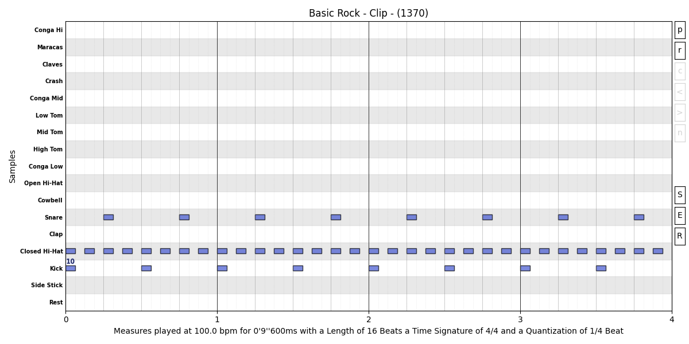
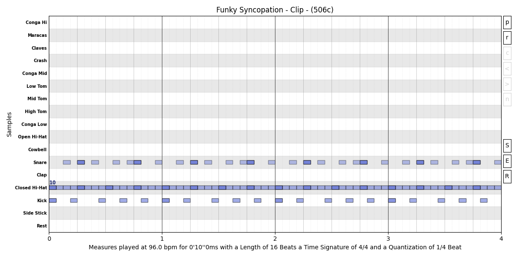
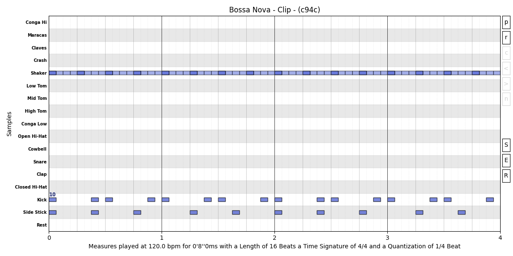

# Common Patterns
For the Chrome browser you can add the following extension
[Midi Player](https://chromewebstore.google.com/detail/khppfbnjbaampmeeiocjhcodkklkcfjf?utm_source=item-share-cb)
in order to play the **Midi Files** below directly in the browser.


## Basic Rock
### Code
```py
from jsonmidicreator import *

settings << Tempo(100)

basic_rock: str = (
    "pc::17," # Power Kit, Preset 17 ("pc" for Program Change)
)

clip = Clip(DrumKit("808"), Title("Basic Rock"), Line(basic_rock))
clip += Trigger("Kick") * 16 % OnBeat()**Odd()
clip += Trigger("Snare") * 16 % OnBeat()**Even()
clip += Trigger("Closed") * 16 % Odd()

clip * 4 << Channel(10) >> Plot()
```

### Plot


[♫ Download MIDI File](midi/Basic_Rock.mid)


## Funky Syncopation
### Code
```py
from jsonmidicreator import *

settings << Tempo(96)

funky_syncopation: str = (
    "t:1/16_0m_2S:Snare:40, :_6S, :_9S, :_11S, :_15S,"
    "t:1/16_0m_4S:Snare:100, :_12S,"
    "t:1/16_0m:Closed:60," + ":," * 15 +
    "t:1/16_0m:Kick:90, :_3S::70, :_7S, :_10S, :_13S,"
)

drum_kit = DrumKit("808")
clip = Clip(drum_kit) << Title("Funky Syncopation") \
    << Line(funky_syncopation) << Channel(10) \
    << Equal("Closed")**OnBeat()**Velocity(100)

clip * 4 >> Plot()
```

### Plot


[♫ Download MIDI File](midi/Funky_Syncopation.mid)


## Bossa Nova
### Code
```py
from jsonmidicreator import *

settings << Tempo(120)

percussion_preset: str = (
    # Has to add "," in order to be considered as a Line if set as string
    "pc::32," # Jazz Percussion Preset, the 32
)

clip = Clip(DrumKit("808"), Title("Bossa Nova"), percussion_preset)
# It's a 2 Measures pattern (`* 2`)
clip += Clip(
    "t::Kick, :_6, :_8, :_14,"  # Integers on Position parameter means Step
) * 2
clip += Clip(
    "t::Stick, :_6, :_12,"
    ":_1M_4, :_10,"
)
# It's possible to set an `Element` with a `Token` ("::Shaker:70:")
clip += Trigger("::Shaker:70") * 16 * 2 << OnBeat()**Velocity(110)

clip * 2 << Channel(10) >> Plot()
```

### Plot


[♫ Download MIDI File](midi/Bossa_Nova.mid)

