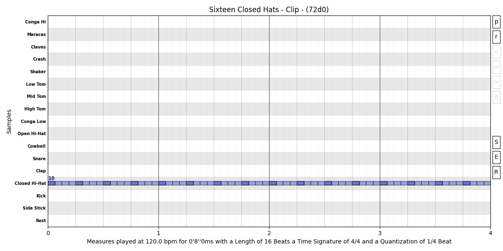

# Frame
The class `Frame` is one of the most important classes, this class allows the focus on specific elements and parameters,
this woks alike the manipulation of a specific knob in a device, where you decide to do an isolated manipulation.
Frames are exclusive to the `Clip` class, and they mainly target to their elements.

## Element Filter
`Element` filters are the most important frames, because they set the scope of the `Clip` content to ba manipulated.

### OnBeat
```py
closed_hats = Trigger("Hat") * 16 << Velocity(70) << OnBeat()**Velocity(110)
closed_hats << DrumKit("808") << Title("Sixteen Closed Hats") << Channel(10)
closed_hats * 4 >> Plot()   # Shows the plot bellow
```

In the first line above, the first Velocity sets all the triggers as 70, but the last Velocity setting
is targeted to only the On Beat triggers. The effect of it can be seen in the following image.



### Stacking Filters
Filters, and for that matter any `Frame`, can be stacked in a recursive fashion, so, for the previous example,
one can specify which On Beat elements one wants to have the velocity increased, so, this changed line would
result in alternated On Beat being set with higher velocity.
```py
closed_hats = Trigger("Hat") * 16 << Velocity(70) << OnBeat()**Odd()**Velocity(110)
```


### Other Filters
- `All`
  - Lets any, or all, input to pass to the next `Frame`.
- `Excluding`
  - Excludes the specified elements and keeps the remaining unmasked elements. Pasted text
- `ElementType`
  - Passes only elements matching the specified types.
- `First`
  - Passes the first specified number of elements.
- `Last`
  - Passes the last specified number of elements.
- `Nth`
  - Passes elements at specified ordinal positions, using 1-based numbering.
- `At`
  - Passes elements at specified indexes, using 0-based numbering.
- `Odd`
  - Passes elements at odd ordinal positions.
- `Even`
  - Passes elements at even ordinal positions.
- `Every`
  - Passes every specified nth element within each measure.
- `Each`
  - Passes elements at a specified 0-based index within each measure.
- `Either`
  - Passes elements matching at least one of the specified conditions.
- `Neither`
  - Passes elements matching none of the specified conditions.
- `Chance`
  - Randomly selects elements according to a probability, using a `Binary` tamer. Pasted text
- `Equal`
  - Passes elements equal to all specified comparison values.
- `NotEqual`
  - Passes elements not equal to all specified comparison values.
- `Above`
  - Passes elements greater than all specified comparison values.
- `Bellow`
  - Passes elements less than all specified comparison values.
- `AboveOrEqual`
  - Passes elements greater than or equal to all specified comparison values.
- `BellowOrEqual`
  - Passes elements less than or equal to all specified comparison values. Pasted text
- `OnBeat`
  - Passes elements positioned on a beat.
- `OffBeat`
  - Passes elements positioned on an offbeat.
- `DownBeat`
  - Passes elements positioned at the beginning of a measure.
- `UpBeat`
  - Passes elements positioned on the last offbeat of a measure.
- `OddStep`
  - Passes elements positioned on odd-numbered steps.
- `EvenStep`
  - Passes elements positioned on even-numbered steps. Pasted text
- `PreviousComparison`
  - Base class for comparing each element with the preceding element's specified parameter.
- `AllMatch`
  - Passes successive elements whose compared values match the preceding element.
- `AllIncreasing`
  - Passes successive elements whose compared values increase.
- `AllDecreasing`
  - Passes successive elements whose compared values decrease.
- `AllNotIncreasing`
  - Passes successive elements whose compared values do not increase.
- `AllNotDecreasing`
  - Passes successive elements whose compared values do not decrease. Pasted text
- `Cross`
  - Passes elements whose duration crosses a specified `Position`.
- `Overlap`
  - Passes elements that overlap a specified `Locus`. Pasted text


