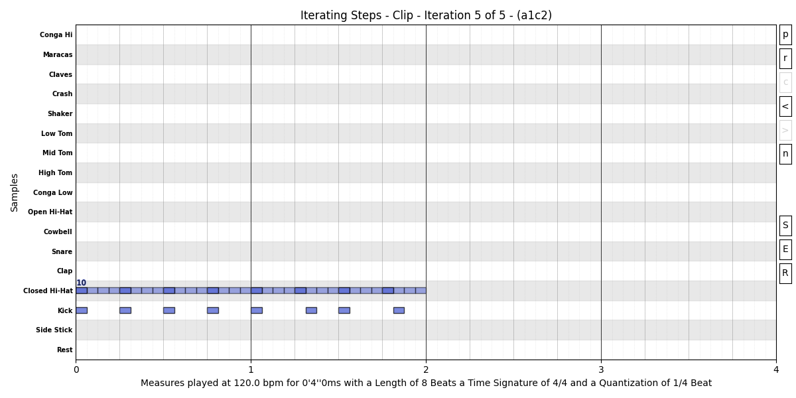

[← Back to README](README.md)

# Iterations
There is a special `Transformation` sub `Operand` type called `IteratedTransformation`,
this operand is split in two types:
- IFrame
    - This is the easier and faster way of iterate a given `Clip`, because the source of
    Chaos is placed in the `Frame` with the process of transformation in it.
- ITame
    - This requires more configuration where the source of Chaos (`Tamer`) is in the Operand
    itself together with the process of transformation.

The first type is the recommended one, because it's more intuitive and immediate.

## Moving Steps

```py
# The pattern
simple_pattern = Trigger("Hat") * 16 << Velocity(70) << OnBeat()**Velocity(110)
simple_pattern += Trigger("Kick") * 16 & OnBeat()
simple_pattern << DrumKit("808") << Channel(10) << Title("Iterating Steps")
simple_pattern *= 2
# The iteration
framed_trigger = Equal("Kick")**Chance(1/8)**Step(1)
i_frame = IAdd(framed_trigger, no_repetitions=True)
# Finally start iterating
simple_pattern >> Plot(i_frame)
# Realization the Iteration 5 is quite usable
```



