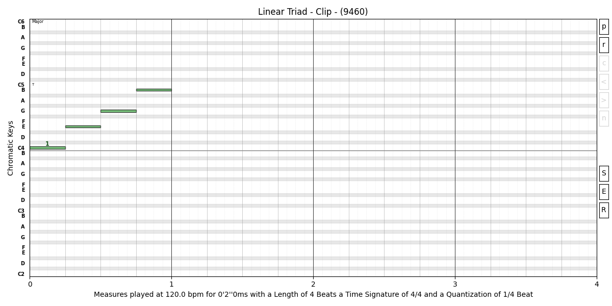
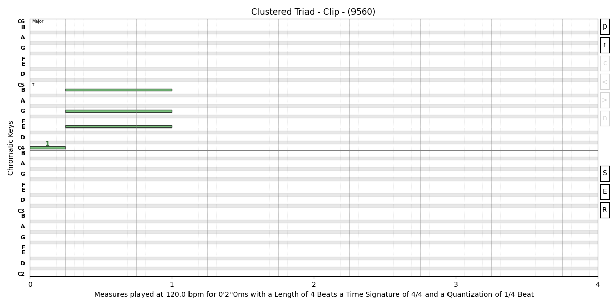
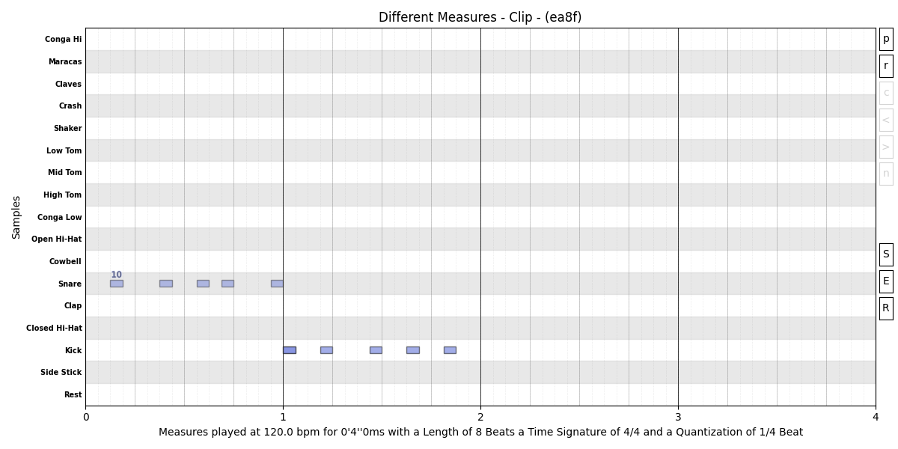
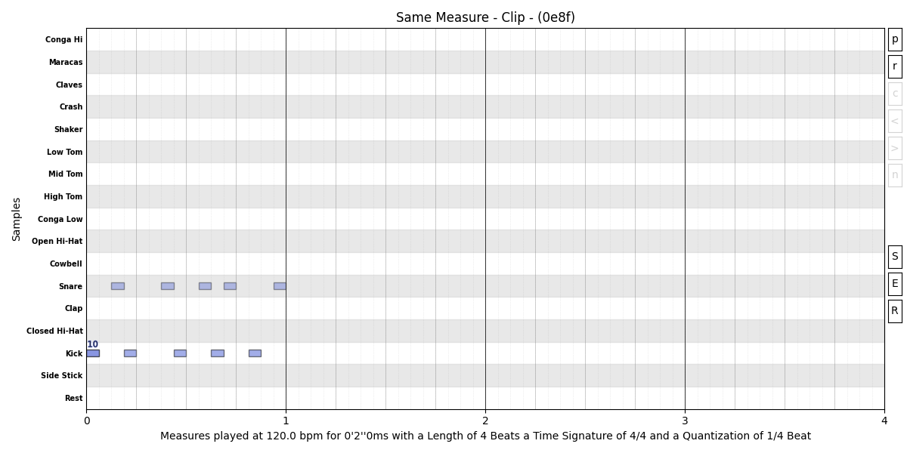

# Line
A `Line` is intended to target a `Clip` and set its containing elements. It's possible to pass a line without the `Line()` operand, as long as the line string has at least one `","`.

These both code lines set the clip with the same content, a triad rooted in *A*, because the second string has a `","`.
- `Clip() << Line("c:1m:A")`
- `Clip() << "c:1m:A,"`

A line has this tree structure:
- `Line`
    - `Token`
        - `Parameter`

## Line components

| Component   | Separator |
|-------------|-----------|
| Token       | `,`       |
| Field       | `:`       |
| Parameter   | `_`       |

### Examples

- `"t:1/16_0m_2S:Snare:40, :_6S, :_9S, :_11S, :_15S,"`
    - In this example one can see 5 tokens separated with `,`, the first token as `"t:1/16_0m_2S:Snare:40"`, where *t* stands for `Trigger`, with the second `Field`, representing
    its `Locus`, placement on the "staff", with the first `Parameter` setting its `Duration`.
    - The following tokens, `":_6S, :_9S, :_11S, :_15S,"`, inherit the previous configurations, so, they are all implicitly triggers ('t'), and they don't set any durations but just positions where 'S' means `Step` and is the default meaning for integer, so, the same line could also be written as `":_6, :_9, :_11, :_15,"`. 


## Token
In a `Line`, the first `Token` is related to the type of `Element`, these are the chars associated to each of those types.

| Acronym | Element         |
|---------|-----------------|
| 'r'     | `Rest`          |
| 't'     | `Trigger`       |
| 'n'     | `Note`          |
| 'c'     | `Chord`         |
| 'cl'    | `Cluster`       |
| 'tp'    | `Tuplet`        |
| 'cc'    | `ControlChange` |
| 'at'    | `Aftertouch`    |
| 'pb'    | `PitchBend`     |
| 'a'     | `Automation`    |
| 'pc'    | `ProgramChange` |
| 'msb'   | `BankSelectMSB` |
| 'lsb'   | `BankSelectLSB` |

### Examples

- `"n:1/4, :1/4, :1/4, :1/4"`
    - In this example the first char means a Note, the default element if none is specified and not inherited, this `Line` represents a sequence of 4 quarter notes at the middle C.
- `"n:1/8:C5#, n_9:1/8::75"`
    - The first `Token`, has `"C5#"`, this is the `Pitch` `Field` in the case of a note, and sets the note as *C#* in the `Octave` `5`, the following token inherits this note pitch if nothing is
    specified in the same field, which in the given example is the case;
    - The second `Token` has `"n_9"`, this stands for `Note` on the midi `Channel` `9`, while the last one, `"75"`, sets the note `Velocity`.


## Position and special chars
### The Stem char (`|`)

The position of elements, that reside in the 2nd `Field`, by default stacks on the previous element in a finish-to-start relationship.
This is the reality of most of the cases, but sometimes there is the need to break this chaining sequence, for that reason there are some special chars that change this behavior.

```py
# In the pitch field, integers are Octaves, like `3`, but `3n` means natural 3rd degree
linear_triad = Clip("::1n, ::3n, ::5n, ::7n")
linear_triad << Title("Linear Triad") >> Plot(block=False)
# Here the special `|` char at the `Locus` `Field` stacks in a start-to-start fashion
clustered_triad = Clip("::1n, :3b:3n, :|:5n, :|:7n")
clustered_triad << Title("Clustered Triad") >> Plot()
```

Note that the `clustered_triad` has the duration of the second note, in the second `Field`, set with `3b`, meaning a duration of 3 beats.

Bellow is the resulting plotting of the notes.





### The Return char (`<`)

One a single and long line is written, at some point the elements change the `Measure` where they are written on, for most cases that
isn't a problem, however when one is writing a patter of multiple samples, it is useful to restart from the beginning for each sample.

```py
# Without using the Return char (`<`)
single_line_1: str = (
    "t:_2:Snare:40, :_6, :_9, :_11, :_15,"
    "t:_0:Kick:90, :_3S::70, :_7, :_10, :_13,"
)   # Add parenthesis in order to concatenate
different_measures = Clip(single_line_1) << DrumKit("808") << Title("Different Measures") << Channel(10)
different_measures >> Plot(block=False)
# Using the Return char (`<`)
single_line_2: str = (
    "t:_2:Snare:40, :_6, :_9, :_11, :_15,"
    "t:<_0:Kick:90, :_3S::70, :_7, :_10, :_13,"
)   # Add parenthesis in order to concatenate
same_measure = Clip(single_line_2) << DrumKit("808") << Title("Same Measure") << Channel(10)
same_measure >> Plot()
```

The return char (`<`) in the second line made sure the Kick started from the beginning.




