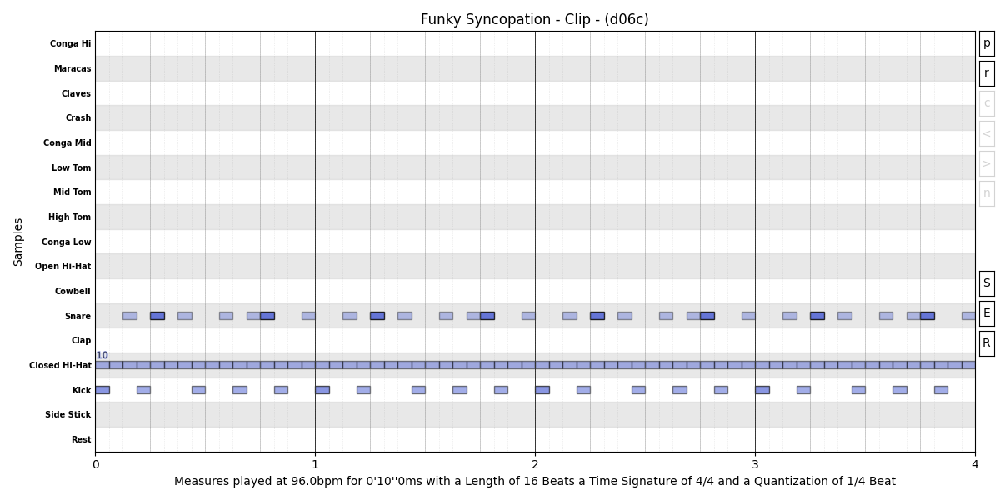

# Common Patterns
## Basic Rock


## Funky Syncopation
### Code
```py
from jsonmidicreator import *

settings << Tempo(96)

funky_syncopation: str = (
    "t:1/16_0m_2S:Snare:40, :_6S, :_9S, :_11S, :_15S,"
    "t:1/16_0m_4S:Snare:100, :_12S,"
    "t:1/16_0m:Closed:60," + ":," * 15 +
    "t:1/16_0m:Kick:90, :_3S::70, :_7S, :_10S, :_13S,"
)

drum_kit = DrumKit("808")
clip = Clip(drum_kit) << Title("Funky Syncopation") \
    << Line(funky_syncopation) << Channel(10) \
    << Equal("Closed")**OnBeat()**Velocity(100)

clip * 4 >> Plot()
```

### Plot


[▶ Listen Audio](Funky_Syncopation.mp3)

[▶ Listen Midi](Funky_Syncopation.mid)

